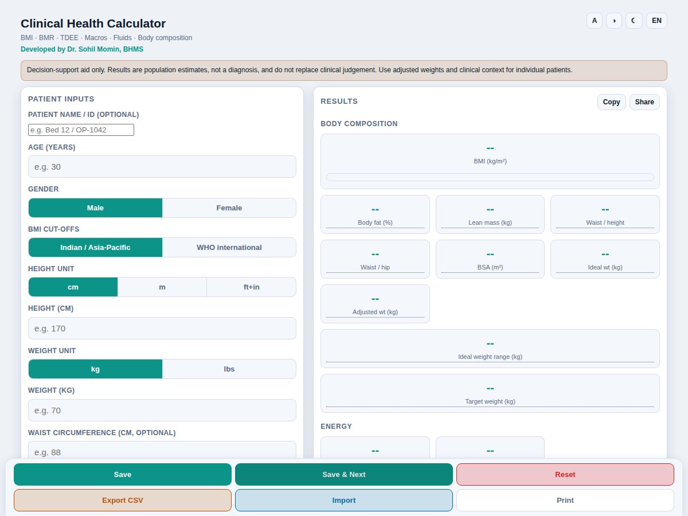
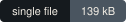
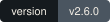
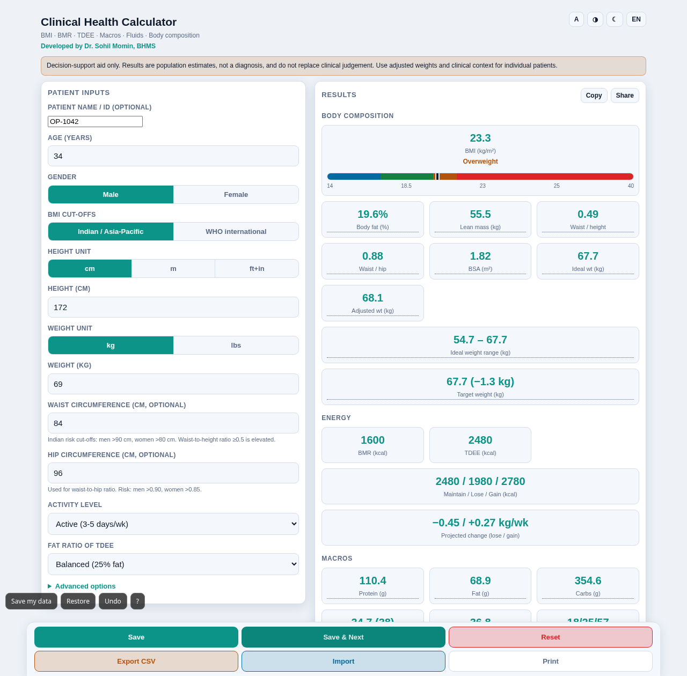
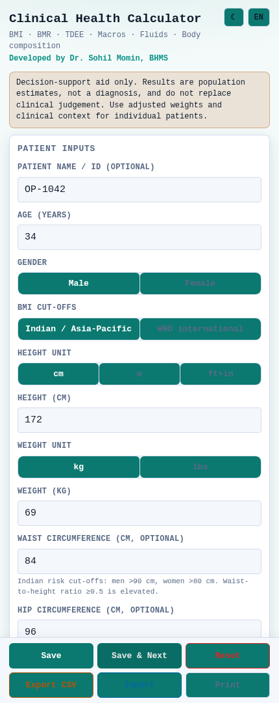

<div align="center">

# Clinical Health Calculator

<!-- shot:start -->



<!-- shot:end -->

**BMI · BMR · TDEE · macros · fluids · body composition · renal · dosing · stroke risk**

A single-file clinical calculator for adult outpatients that prints the formula behind every number. No build step, no dependencies, no server, no accounts, no tracking.

[](https://github.com/drsamonline/bmi-bmr-tdee-macros-fluid-calculator)
[](https://github.com/drsamonline/bmi-bmr-tdee-macros-fluid-calculator)
[](https://github.com/drsamonline/bmi-bmr-tdee-macros-fluid-calculator)
[](https://github.com/drsamonline/bmi-bmr-tdee-macros-fluid-calculator/actions)
[](https://github.com/drsamonline/bmi-bmr-tdee-macros-fluid-calculator)
[](LICENSE)
[](CHANGELOG.md)

[**Landing page**](https://drsamonline.github.io/bmi-bmr-tdee-macros-fluid-calculator/) &nbsp;·&nbsp;
[**Open the calculator**](https://drsamonline.github.io/bmi-bmr-tdee-macros-fluid-calculator/play/) &nbsp;·&nbsp;
[**Download**](https://github.com/drsamonline/bmi-bmr-tdee-macros-fluid-calculator/releases/latest) &nbsp;·&nbsp;
[**All projects**](https://drsamonline.github.io/)

</div>

> Every badge above is an SVG file in `docs/assets/`, drawn by `scripts/badges.py` and committed. An offline-first app should not need an image service to describe itself.

---

## Download

All four builds come from the same commit as the live demo, and the Windows and Android binaries carry this app's own icon — the ECG mark, drawn in this repository and stamped into the executable and the launcher by the build pipeline.

| | Build | What it is |
|---|---|---|
|  **Windows** | [`bmi-bmr-tdee-macros-fluid-calculator-portable.exe`](https://github.com/drsamonline/bmi-bmr-tdee-macros-fluid-calculator/releases/latest/download/bmi-bmr-tdee-macros-fluid-calculator-portable.exe) | One portable executable. No installer, no registry writes, no admin rights. |
|  **Android** | [`bmi-bmr-tdee-macros-fluid-calculator.apk`](https://github.com/drsamonline/bmi-bmr-tdee-macros-fluid-calculator/releases/latest/download/bmi-bmr-tdee-macros-fluid-calculator.apk) | Signed APK. Sideload only — allow installs from unknown sources. |
|  **Linux** | [`bmi-bmr-tdee-macros-fluid-calculator-linux`](https://github.com/drsamonline/bmi-bmr-tdee-macros-fluid-calculator/releases/latest/download/bmi-bmr-tdee-macros-fluid-calculator-linux) | Single portable binary. `chmod +x` and run. |
|  **Any browser** | [`index.html`](https://raw.githubusercontent.com/drsamonline/bmi-bmr-tdee-macros-fluid-calculator/main/index.html) | One HTML file. Save it, open it, or add it to a phone's home screen. |

---

## Screenshots

| Desk — from 960 px | Phone — one column |
|---|---|
|  |  |

Both are photographs of the app with a patient entered, taken by `scripts/shot.py`. The landing page embeds the app itself in a frame, driven by four guided buttons — the demo is the product, not a picture of it.

---

## What it computes

| Area | Outputs |
|------|---------|
| **Body composition** | BMI with category and gauge, body-fat % (Deurenberg), lean body mass, body surface area (Mosteller), ideal body weight (Devine), adjusted body weight, waist-to-height ratio, waist-to-hip ratio, ideal weight range and target weight |
| **Energy** | BMR (Mifflin–St Jeor), TDEE (activity multipliers), calorie targets (maintain / lose / gain) and projected weekly weight change |
| **Macros** | Protein, fat, carbohydrate and fiber; protein per meal; macro split (% of calories) |
| **Fluids** | Daily fluid requirement (30 mL/kg baseline, adjusted for climate, exercise, fever and breastfeeding), shown in mL / L / glasses |
| **Renal** | Creatinine clearance (Cockcroft–Gault) from a serum creatinine, with its formula and limits |
| **Dosing** | Weight-based (rate × weight) and surface-area-based (rate × BSA) dose, with the unit shown at every step |
| **Risk scores** | CHA₂DS₂-VASc — stroke risk in non-valvular atrial fibrillation, with its source and intended population |
| **Risk & flags** | Indian/Asia-Pacific **and** WHO BMI cut-offs; cautions for renal/hepatic disease, heart failure, athletes and paediatric patients |

## The working, shown

Every result is printed with its formula and your own values substituted, in a "Show the working" panel:

```
BMI   = 23.3      weight ÷ height² = 69 ÷ 1.72²
BMR   = 1600      10×wt + 6.25×ht − 5×age + 5 = 10×69 + 6.25×172 − 5×34 + 5
TDEE  = 2480      BMR × activity = 1600 × 1.55
CrCl  = 101.6     (140 − age) × wt ÷ (72 × Scr) = (140 − 34) × 69 ÷ (72 × 1.0)
```

A number you can check is worth more than a number you must trust — and it makes the app teachable and auditable without reading JavaScript.

## Features

- **Responsive layout** — a single mobile column on phones, and a two-column desktop view (inputs and saved entries on the left, a sticky results panel on the right) from 960 px up.
- **Real-time** recalculation as you type, and **unit conversion that preserves values** — cm / m / ft+in and kg / lbs switch without losing what you entered.
- **Saved entries** in `localStorage`, each with an optional patient name/ID and a timestamp; delete with undo, filter, load back into the form, and a **BMI trend chart** across saved entries.
- **CSV export and import** (with formula-injection protection) and **print / PDF** output.
- **Copy / Share** a formatted text summary of the current result.
- **Trilingual UI** — English, हिन्दी and ગુજરાતી.
- **Light / dark theme**, respecting the system preference.
- **Accessible** — ARIA radiogroups, live result region, keyboard navigation, focus-visible states, hover definitions on every metric, and a print stylesheet.
- **Installable** — a web app manifest and a service worker (document network-first, assets cache-first, cache name stamped from the version), so "Add to Home Screen" installs an app rather than a bookmark, and a shipped update cannot hide behind a stale cache. A build stamp in the footer answers "am I on the new one?".
- **A printed clinical note** — the print stylesheet produces a note, not a print of the dashboard: patient, age, sex, measurements, BMI and date in a header, the results in three columns, the working underneath in small type, and a signature line. The form is not printed; the record is.
- **Change since the last entry** — for a returning patient the results panel states the difference from their previous saved entry (weight, BMI, waist, body fat) with the interval, matched on the patient name/ID.
- **Readable in the consulting room** — three text sizes and a high-contrast mode, both remembered; `lang` follows the interface language so a screen reader pronounces Hindi and Gujarati.
- **Keyboard-first entry** — Enter advances through the form and saves at the end; Alt+1…5 jump to age, height, weight, waist and activity; Ctrl/⌘+S saves, Ctrl/⌘+Enter saves and clears.
- **Fully offline** — self-contained, no external requests; install it, or add it to a home screen on mobile.

## Usage

- **Online:** open the [live calculator](https://drsamonline.github.io/bmi-bmr-tdee-macros-fluid-calculator/play/).
- **Offline:** download [`index.html`](https://raw.githubusercontent.com/drsamonline/bmi-bmr-tdee-macros-fluid-calculator/main/index.html) and open it in any modern browser.
- **On mobile:** open the file or link, then "Add to Home Screen".

## Repository contents

| Path | Purpose |
|------|---------|
| `index.html` | Production build — the minified single-file app. |
| `src/clinical-health-calculator.html` | The same app, un-minified and commented, for editing. |
| `docs/index.html` | The landing page — this project's own design, not a copy of the app. |
| `docs/play/` | The app as GitHub Pages serves it, plus its `icon.svg` / `icon.png`. |
| `docs/assets/` | Generated: badges, app icons, platform glyphs, screenshots, social card. |
| `scripts/build.js` | Minifies `src/` into `index.html` and `docs/play/index.html`, and stamps the service worker's cache name from the app version. `npm run build`. |
| `docs/play/manifest.webmanifest` | The install manifest: standalone, `start_url`, icons that live inside the app folder because that is all the EXE and APK bundle. |
| `docs/play/sw.js` | The service worker. Documents network-first, assets cache-first, cache name stamped at build time. |
| `scripts/badges.py` | Draws the badges. Run it after a change that alters a claim. |
| `scripts/make_icons.py` | Draws the app icon at every size, including the one the release pipeline stamps into the EXE and APK. |
| `scripts/shot.py` | Takes the screenshots with headless Chromium, over a throwaway local server. |
| `ROADMAP.md` | Offline-only enhancements, ordered by clinical value. |
| `LICENSE` | PolyForm Noncommercial licence. |

To rebuild after editing the source:

```
npm install
npm run build     # src/ -> index.html + docs/play/index.html, and the worker's cache name
npm test
```

The build compresses but does not rename: the shipped file is the file a colleague is meant to be able to audit, so `function calculate` stays `function calculate`.

## Tests

The app carries its own known-value self-tests — one per calculator, plus a units-consistency check. The suite adds 58 checks in total: the calculators, the working panel, the CSV writer, the manifest and its icons, the service-worker cache name, the text-size and contrast controls, the change-since-last-entry line, the printed note's header and the Enter-key flow. Open `index.html?selftest=1` and read the console, or run them headlessly:

```
npm install
npm test
```

`test/selftest.js` loads the built `index.html` in a headless DOM, runs the self-tests, and drives the calculator (creatinine clearance, the "Show the working" panel, dosing, CHA₂DS₂-VASc). `.github/workflows/test.yml` runs it on every push.

## Changelog

**2.6.0 — 2026-11-01**
- **Installable.** A web app manifest and a service worker, so "Add to Home Screen" installs an app instead of a bookmark. The document is served network-first with the cache only as the offline fallback, assets cache-first with a background refresh, and the cache name is stamped from the version at build time — the failure this avoids is a shipped release that a returning reader never sees. A build stamp in the footer answers "am I on the new one?".
- **A printed clinical note.** The print stylesheet now produces a note rather than a print of the dashboard: a header with the patient, age, sex, measurements, BMI and date; results in three columns; the working underneath; a signature line. The input form is no longer printed.
- **Change since the last entry.** For a returning patient the results panel states the difference from their previous saved entry — weight, BMI, waist, body fat — with the interval between visits, matched on the patient name/ID.
- **Readable in the consulting room.** Three text sizes and a high-contrast mode, both remembered. The interface language already set `lang`; that now covers the new controls too.
- **Keyboard-first entry.** Enter advances through the form and saves at the end of it; Alt+1…5 jump to age, height, weight, waist and activity.
- **Rounding, stated.** The working panel now says how every figure was rounded, so a printed number can be reproduced.
- The build is scripted (`npm run build`): one source, two identical artefacts, and the pipeline's "the demo must be the app" check is satisfied by construction rather than by hand.
- The suite grew from 40 checks to 58.
- Fixed: the data toolbar sat on top of the action bar and covered Export CSV.

**2.5.0 — 2026-11-01**
- **The released binaries carry this app's icon.** The build pipeline looks for `docs/play/icon.png` and was finding nothing, so the EXE and the APK shipped with the builder's fallback glyph. The artwork now lives where the pipeline looks, and `scripts/make_icons.py` regenerates it at every size.
- **Badges are files, not requests.** `scripts/badges.py` draws them into `docs/assets/`; the README and the landing page reference them by relative path, so nothing on either surface fetches from an image service.
- **A landing page of its own.** Paper, serif and amber against the app's pale teal instrument panel — the two surfaces no longer read as one product twice. Light and dark, with a remembered toggle under its own storage key.
- **The demo is the app.** The landing page embeds the real calculator in a frame and drives it with four guided buttons; a poster sits behind the frame so a blocked frame still shows the product.
- Screenshots of the real app at desk and phone widths, taken by `scripts/shot.py`.

**2.4.0**
- New: **CHA₂DS₂-VASc** — a stroke-risk score for non-valvular atrial fibrillation, shown with its components in the "Show the working" panel and its intended population stated.
- Self-tests extended: CHA₂DS₂-VASc age-band checks.

**2.3.0**
- New: **dosing** — weight-based (mg/kg × weight) and surface-area-based (mg/m² × BSA) dose, each shown with its formula.
- Self-tests extended: dosing known-value checks.

**2.2.0**
- **Show the working** — a panel listing every result with its formula and the values substituted.
- New: **creatinine clearance** (Cockcroft–Gault) from an optional serum creatinine, with its formula, units and limits.
- Self-tests extended: known-value checks for creatinine clearance plus a units-consistency check.

**2.1.0**
- Responsive desktop/tablet layout, hip circumference and waist-to-hip ratio, ideal weight range, target weight, protein per meal, macro split %, hover definitions, BMI trend chart, copy and share.

**2.0.0**
- Clinical additions: BMI categories with Indian/WHO cut-offs, carbohydrates, IBW/adjusted BW/BSA/body-fat/lean mass, waist-to-height, calorie targets, fluid adjustments, caution flags, adult-only guard.
- Data: `localStorage`, patient ID and timestamps, delete/undo, filter, CSV import, print. Accessibility, trilingual UI, light/dark theme, minified single-file build.

## Formulas & references

- **BMR** — Mifflin MD, St Jeor ST, et al. *Am J Clin Nutr* 1990;51:241–7.
- **TDEE** — standard activity multipliers (1.2 / 1.375 / 1.55 / 1.725 / 1.9).
- **BMI cut-offs** — WHO international and WHO Asia-Pacific / ICMR Indian cut-offs.
- **Protein & fiber** — IOM Dietary Reference Intakes; ACSM/NSCA protein range 0.8–2.0 g/kg.
- **Fluid** — 30 mL/kg/day adult baseline (EFSA / IOM general guidance).
- **Ideal body weight** — Devine BJ. *Drug Intell Clin Pharm* 1974. Adjusted BW = IBW + 0.25 × (actual − IBW).
- **BSA** — Mosteller RD. *N Engl J Med* 1987;317:1098.
- **Body fat** — Deurenberg P, et al. *Br J Nutr* 1991;65:105–14.
- **Waist** — IDF / WHO Asia-Pacific cut-offs (men >90 cm, women >80 cm); waist-to-hip >0.90 (men) / >0.85 (women).
- **Creatinine clearance** — Cockcroft DW, Gault MH. *Nephron* 1976;16:31–41. Adults 18+; needs steady-state renal function and a steady-state serum creatinine; not valid in pregnancy or at extremes of body size.
- **Dosing** — weight-based (rate × actual weight) and surface-area-based (rate × BSA, Mosteller). Arithmetic only; not a prescribing decision.
- **CHA₂DS₂-VASc** — Lip GYH, et al. *Chest* 2010;137:263–72. **Intended population: non-valvular atrial fibrillation.** Not a general risk score; it does not decide treatment.

## Disclaimer

This is a **decision-support aid only**. Results are population estimates, not a diagnosis, and do not replace clinical judgement. Use adjusted weights and clinical context for individual patients, and apply appropriate caution for renal, cardiac and paediatric cases.

## Author

Developed by **Dr. Sohil Momin, BHMS** — Vadodara, Gujarat, India. The original calculator, its clinical design and the choice of formulas are his work; this repository is the maintained, enhanced and minified release of it.

## License

Released under the **PolyForm Noncommercial License 1.0.0** — see [LICENSE](LICENSE). © 2026 Dr. Sohil Momin.

---

Made with care by [Dr. Sohil Momin](https://github.com/drsamonline).
