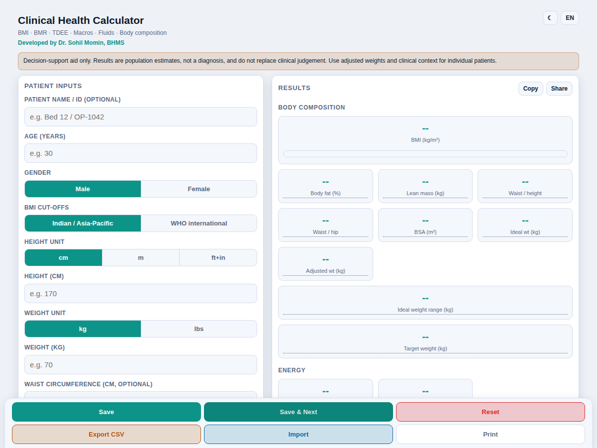

<div align="center">

# Clinical Health Calculator

<!-- shot:start -->



<!-- shot:end -->

**BMI · BMR · TDEE · Macros · Fluids · Body Composition**

A single-file, offline-capable clinical calculator for adult outpatients — no build step, no dependencies, no server, no tracking.

[](https://drsamonline.github.io/bmi-bmr-tdee-macros-fluid-calculator/)
[](https://drsamonline.github.io/)
[](https://drsamonline.github.io/bmi-bmr-tdee-macros-fluid-calculator/play/)
[](https://github.com/drsamonline/bmi-bmr-tdee-macros-fluid-calculator)

[](LICENSE)
[](https://github.com/drsamonline/bmi-bmr-tdee-macros-fluid-calculator)
[](https://github.com/drsamonline/bmi-bmr-tdee-macros-fluid-calculator)
[](https://github.com/drsamonline/bmi-bmr-tdee-macros-fluid-calculator)
[](https://github.com/drsamonline/bmi-bmr-tdee-macros-fluid-calculator/commits/main)

</div>

> **Landing page:** https://drsamonline.github.io/bmi-bmr-tdee-macros-fluid-calculator/ &nbsp;·&nbsp; **Live demo:** https://drsamonline.github.io/bmi-bmr-tdee-macros-fluid-calculator/play/

**Download:** [Windows (.exe)](https://github.com/drsamonline/bmi-bmr-tdee-macros-fluid-calculator/releases/latest/download/bmi-bmr-tdee-macros-fluid-calculator-portable.exe) &nbsp;·&nbsp; [Android (.apk)](https://github.com/drsamonline/bmi-bmr-tdee-macros-fluid-calculator/releases/latest/download/bmi-bmr-tdee-macros-fluid-calculator.apk)

---

## Author

Developed by **Dr. Sohil Momin, BHMS** — Vadodara, Gujarat, India.

The original calculator, its clinical design and the choice of formulas are his work. This repository is the maintained, enhanced and minified release of that original code.

---

## What it computes

| Area | Outputs |
|------|---------|
| **Body composition** | BMI with category and gauge, body-fat % (Deurenberg), lean body mass, body surface area (Mosteller), ideal body weight (Devine), adjusted body weight, waist-to-height ratio, waist-to-hip ratio, ideal weight range and target weight |
| **Energy** | BMR (Mifflin–St Jeor), TDEE (activity multipliers), calorie targets (maintain / lose / gain) and projected weekly weight change |
| **Macros** | Protein, fat, carbohydrate and fiber; protein per meal; macro split (% of calories) |
| **Fluids** | Daily fluid requirement (30 mL/kg baseline, adjusted for climate, exercise, fever and breastfeeding), shown in mL / L / glasses |
| **Renal** | Creatinine clearance (Cockcroft&ndash;Gault) from a serum creatinine, with its formula and limits |
| **Dosing** | Weight-based (rate &times; weight) and surface-area-based (rate &times; BSA) dose, with the unit shown at every step |
| **Risk scores** | CHA₂DS₂-VASc — stroke risk in non-valvular atrial fibrillation, with its source and intended population |
| **Risk & flags** | Indian/Asia-Pacific **and** WHO BMI cut-offs; cautions for renal/hepatic disease, heart failure, athletes and paediatric patients |

## Features

- **Responsive layout** — a single mobile column on phones, and a two-column desktop view (inputs and saved entries on the left, a sticky results panel on the right) from 960 px up. Larger type and a three-across result grid on big screens.
- **Real-time** recalculation as you type.
- **Unit conversion that preserves values** — cm / m / ft+in and kg / lbs switch without losing what you entered.
- **Saved entries** in `localStorage`, each with an optional patient name/ID and a timestamp; delete with undo, filter, load back into the form, and a **BMI trend chart** across saved entries.
- **CSV export and import** (with formula-injection protection) and **print / PDF** output.
- **Copy / Share** a formatted text summary of the current result.
- **Trilingual UI** — English, हिन्दी and ગુજરાતી.
- **Light / dark theme**, respecting the system preference.
- **Accessible** — ARIA radiogroups, live result region, keyboard navigation, focus-visible states, hover definitions on every metric, a "What these mean" panel, and a print stylesheet.
- **Show the working** — every result lists its formula with your values substituted, in a "Show the working" panel, so it can be checked rather than trusted.
- **Fully offline** — self-contained, no external requests; add to home screen on mobile.

## Usage

- **Online:** open the [live demo](https://drsamonline.github.io/bmi-bmr-tdee-macros-fluid-calculator/play/).
- **Offline:** download [`index.html`](https://raw.githubusercontent.com/drsamonline/bmi-bmr-tdee-macros-fluid-calculator/main/index.html) and open it in any modern browser.
- **On mobile:** open the file/link, then "Add to Home Screen".

## Repository contents

| File | Purpose |
|------|---------|
| `index.html` | Production build — the minified single-file app (this is what GitHub Pages serves). |
| `src/clinical-health-calculator.html` | The same app, un-minified and commented, for editing. |
| `LICENSE` | PolyForm Noncommercial licence. |

To rebuild after editing the source, minify `src/clinical-health-calculator.html` into `index.html` with any HTML minifier.

## Changelog

**v2.4.0**
- New: **CHA₂DS₂-VASc** — a stroke-risk score for non-valvular atrial fibrillation, shown with its components in the "Show the working" panel and its intended population stated.
- Self-tests extended: CHA₂DS₂-VASc age-band checks.

**v2.3.0**
- New: **dosing** — weight-based (mg/kg × weight) and surface-area-based (mg/m² × BSA) dose, each shown with its formula in the "Show the working" panel.
- Self-tests extended: dosing known-value checks.

**v2.2.0**
- **Show the working** — a panel that lists every result with its formula and the values substituted, so a number can be checked rather than trusted.
- New: **creatinine clearance** (Cockcroft–Gault) from an optional serum creatinine, with its formula, units and limits.
- Self-tests extended: known-value checks for creatinine clearance plus a units-consistency check (BMI from cm equals BMI from m).

**v2.1.0**
- Responsive desktop/tablet layout (two-column, sticky results, three-across tiles).
- New tools: hip circumference and **waist-to-hip ratio**; **ideal weight range** and **target weight** with the change needed; **protein per meal**; **macro split %**.
- New info: hover definitions on every result, a "What these mean" panel.
- New: **BMI trend chart** across saved entries; **Copy** and **Share** summary buttons.
- Extended CSV export/import with the new fields.

**v2.0.0**
- Clinical additions: BMI category with Indian/WHO cut-offs, carbohydrates, IBW/adjusted BW/BSA/body-fat/lean mass, waist-to-height ratio, calorie targets with projected change, fluid adjustments, clinical caution flags, disclaimer, adult-only guard.
- Data: `localStorage`, patient ID and timestamps, delete/undo, filter, CSV import, print.
- Accessibility, trilingual UI, light/dark theme, minified single-file build.

## Formulas & references

- **BMR** — Mifflin MD, St Jeor ST, et al. *Am J Clin Nutr* 1990;51:241–7.
- **TDEE** — standard activity multipliers (1.2 / 1.375 / 1.55 / 1.725 / 1.9).
- **BMI cut-offs** — WHO international and WHO Asia-Pacific / ICMR Indian cut-offs.
- **Protein & fiber** — IOM Dietary Reference Intakes; ACSM/NSCA protein range 0.8–2.0 g/kg.
- **Fluid** — 30 mL/kg/day adult baseline (EFSA / IOM general guidance).
- **Ideal body weight** — Devine BJ. *Drug Intell Clin Pharm* 1974. Adjusted BW = IBW + 0.25 × (actual − IBW).
- **BSA** — Mosteller RD. *N Engl J Med* 1987;317:1098.
- **Body fat** — Deurenberg P, et al. *Br J Nutr* 1991;65:105–14.
- **Waist** — IDF / WHO Asia-Pacific cut-offs (men >90 cm, women >80 cm); waist-to-hip >0.90 (men) / >0.85 (women).
- **Creatinine clearance** — Cockcroft DW, Gault MH. *Nephron* 1976;16:31–41. Adults 18+; needs steady-state renal function and a steady-state serum creatinine; not valid in pregnancy or at extremes of body size.
- **Show the working** — each result is rendered with its formula and the substituted values; the arithmetic is the app's own, not a lookup.
- **Dosing** — weight-based (rate × actual weight) and surface-area-based (rate × BSA, Mosteller). Arithmetic only; not a prescribing decision — check the product's own dosing and the patient.
- **CHA₂DS₂-VASc** — Lip GYH, et al. *Chest* 2010;137:263–72. Congestive heart failure (1), hypertension (1), age ≥75 (2), diabetes (1), prior stroke/TIA/thromboembolism (2), vascular disease (1), age 65–74 (1), female sex (1). **Intended population: non-valvular atrial fibrillation.** Not a general risk score; it does not decide treatment.

## Tests

The app carries its own known-value self-tests — one per calculator, plus a
units-consistency check. Open `index.html?selftest=1` and read the console, or run
them headlessly:

```
npm install
npm test
```

`test/selftest.js` loads the built `index.html` in a headless DOM, runs the
self-tests, and drives the calculator (creatinine clearance, the "Show the
working" panel). `.github/workflows/test.yml` runs it on every push.

## Disclaimer

This is a **decision-support aid only**. Results are population estimates, not a diagnosis, and do not replace clinical judgement. Use adjusted weights and clinical context for individual patients, and apply appropriate caution for renal, cardiac and paediatric cases.

## License

Released under the **PolyForm Noncommercial License 1.0.0** — see [LICENSE](LICENSE). © 2026 Dr. Sohil Momin.

---

Made with care by [Dr. Sohil Momin](https://github.com/drsamonline).
